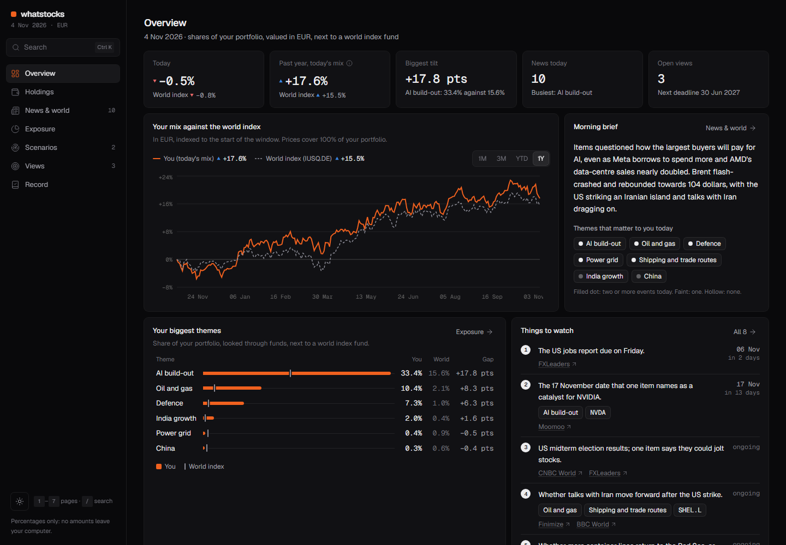
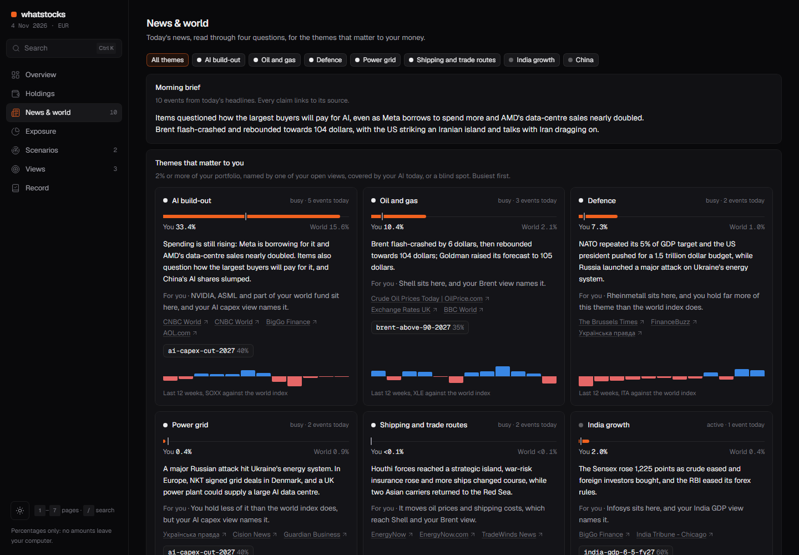
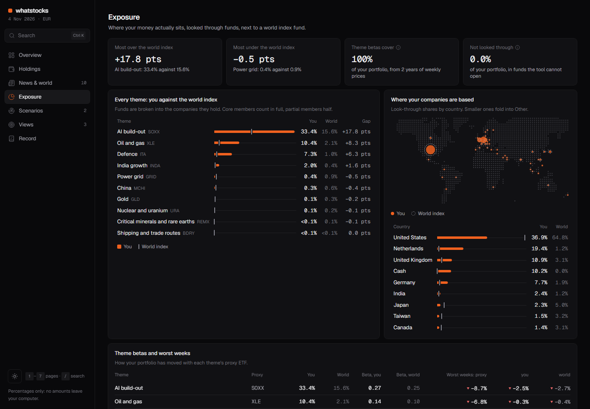
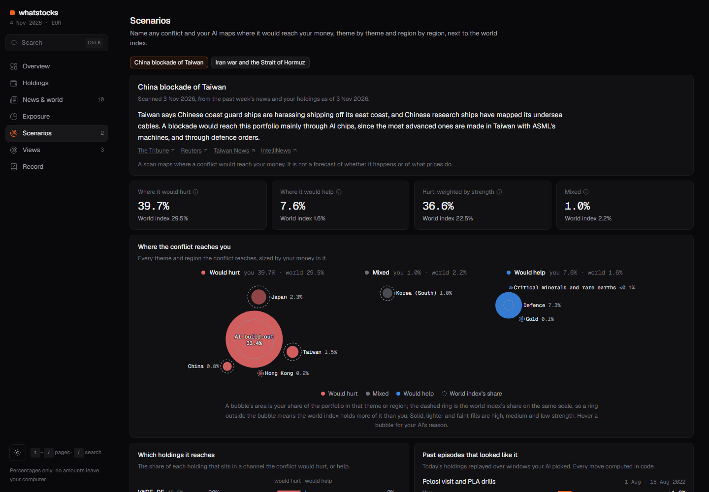
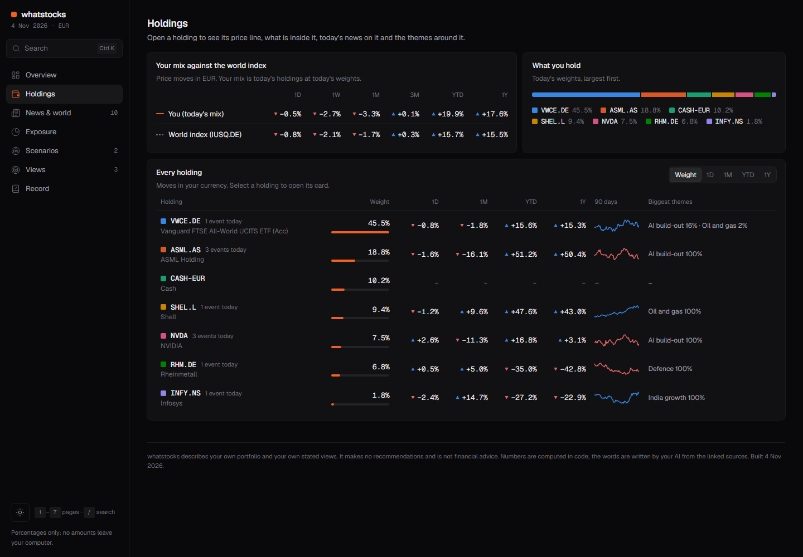
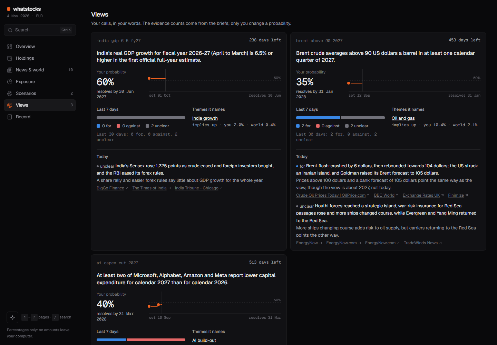
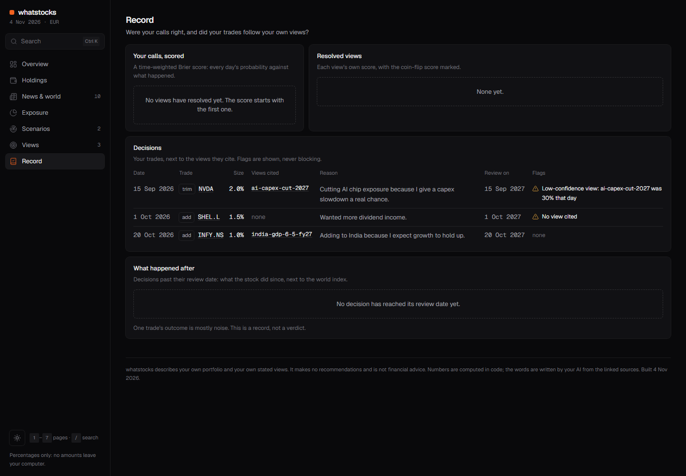

# whatstocks

A personal news and portfolio tracker for geopolitics. Each morning it reads
the world's news against what you own, and shows how events reach your money:
which themes and regions you are exposed to, how that compares with a world
index fund, and how a conflict would ripple through your holdings. You can
also write down what you think will happen, and it keeps score of your calls
over time.

It helps you understand the world and your own relationship with it. It never
tells you what to buy or sell.



Your own AI assistant (Claude Code) runs it on your own machine. There is
no server and no account, and your amounts never leave your computer (see
[What leaves your computer](#what-leaves-your-computer)).

> **Status: early (v0.3).** The whole pipeline, the seven-page dashboard and
> conflict scans run on the demo user, and the tests pass offline. Expect
> rough edges. The design is in [docs/SPEC.md](docs/SPEC.md), and the page's
> design in [docs/DASHBOARD.md](docs/DASHBOARD.md).

## What you see each morning

One page, `dashboard.html`, that works offline and fetches nothing. It has
seven pages, in a dark or a light theme:

| Tab | Question it answers |
|---|---|
| **Overview** | How did my mix do today and over the past year, next to the world index? What matters this morning, and what is coming up? |
| **Holdings** | For each holding: its price line, what is inside it (companies, countries, themes), today's news on it, and the state of the themes around it. |
| **News & world** | Which of the 10 geopolitical themes matter to *my* money today, what state each is in, how events ripple from one theme to another (especially into AI), and what to watch next. |
| **Exposure** | Where is my money actually exposed (AI build-out, defence, oil, India, ...), and how does that compare with a plain world index fund? Which holding puts me into which theme? |
| **Scenarios** | If a conflict I name broke out, where would it reach my money? A bubble map of every theme and region it touches, my share against the world's. |
| **Views** | What do I think will happen, how sure am I, and what did today's news say for or against it? |
| **Record** | Were my past calls right? Did my trades follow my own views? |

<table>
<tr>
<td width="50%"><br><b>News & world.</b> Today's news, theme by theme, with your share next to the world's.</td>
<td width="50%"><br><b>Exposure.</b> Where your money really sits, looked through funds.</td>
</tr>
<tr>
<td><br><b>Scenarios.</b> Where a conflict you name would reach your money.</td>
<td><br><b>Holdings.</b> Each holding's moves, what is inside it and its themes.</td>
</tr>
<tr>
<td><br><b>Views.</b> Your calls, and the news for and against them.</td>
<td><br><b>Record.</b> How your calls scored, and whether your trades followed your views.</td>
</tr>
</table>

The screenshots show the demo: a fictional investor, not a real portfolio.

Press `Ctrl K` (`⌘K` on a Mac) or `/` to jump to any page, holding, theme,
view or scan, or to copy a command for Claude Code. `1` to `7` switch pages,
`T` switches the theme and `Esc` closes a card. Every mark on a chart has a
hover tip.

The **morning brief** covers the day's world events, and it reads each one
through the same four questions:

1. What happened? (with a source link)
2. Where does money move: who pays, and who gets paid?
3. Which themes, regions and holdings of yours does it touch?
4. Does it count for or against any of your views?

The brief does not tell you what to think about an event. It gives you a
fixed way to read one. It must give a line on every theme that is 2% or more
of your portfolio or that one of your views names, and it leaves out the
themes that do not touch you.

### Conflict scans

Type `/scan` and name any conflict, for example "China blockade of Taiwan".
The code searches the past week's news for it. Your AI marks which themes and
regions the conflict would hurt or help, and how strongly. The code then
computes how much of your portfolio, and of the world index, each one reaches
(each company counted once), which of your holdings it reaches, and how
today's holdings did in past episodes your AI picks. The Scenarios tab draws
it as a bubble map. A scan is a map of where a conflict would reach your
money, not a forecast.

## What it will never do

- Tell you to buy or sell anything, or give price targets.
- Place orders, or ask for a broker login that can trade.
- Send money amounts to the AI. The AI sees only tickers and percentages.
- State a fact without a link to a source that the code fetched itself.
- Change your views for you. It shows evidence, and you decide.

## Getting started

You need [uv](https://docs.astral.sh/uv/) and
[Claude Code](https://claude.com/claude-code). uv installs the right Python
version for you.

`/setup` is the onboarding. It takes about 15 minutes, and Claude walks you
through it one step at a time, showing each file it writes:

1. **Your folder.** It creates `my/`, which stays on your computer.
2. **Your currency and benchmark.** The currency you think in, and the world
   index fund to compare against (MSCI ACWI unless you pick another).
3. **Your holdings.** Drop in a broker CSV export or type them in. It maps
   them to `my/holdings.csv` and asks you to check the result. It never
   connects to a broker.
4. **Your themes.** For each stock that sits in none of the 10 themes, it
   proposes one with a reason, and you accept or reject it.
5. **Your views.** It turns 2 or 3 things you believe about the next one to
   three years into dated calls a stranger could check. You set every
   probability; it never suggests one.
6. **Your first morning.** It runs `/morning` and opens your dashboard.

After that, the news, the brief and every chart are about your holdings and
your views.

```text
git clone https://github.com/Aarrushh/whatstocks
cd whatstocks
uv sync
claude
> /setup      # import a broker CSV, write your first 2-3 views
> /morning    # every morning: refresh, read the news, build the page
> /scan       # any time: "China blockade of Taiwan", "Iran war", ...
```

`/setup` creates a `my/` folder. Git ignores it, so your own data never ends
up in a commit. `/morning` runs `whatstocks prepare`, has Claude write the
brief from the payload, then runs `whatstocks finish` and gives you
`my/out/dashboard.html`.

### Try the demo first

The demo is a fictional euro-based investor with three views and three
logged trades.

```text
uv run whatstocks --dir demo prepare
uv run whatstocks --dir demo finish --no-brief
```

Then open `demo/out/dashboard.html`. Inside Claude Code, ask for
"/morning on the demo folder" to get the brief as well, and "/scan Iran war
on the demo folder" for a scan.

## What leaves your computer

| Goes to | What | Why |
|---|---|---|
| Yahoo Finance | The ticker symbols you hold, plus the theme proxy ETFs | Daily prices |
| European Central Bank | Currency codes | Exchange rates |
| iShares | A request for the MSCI ACWI holdings file | Looking through funds |
| News feeds and Google News | The theme search queries in `themes/themes.yaml` | The day's news |
| Google News | The conflict name you type for a scan | The scan's news |
| Your AI (Claude) | Tickers, portfolio percentages, your open views, headlines | Writing the brief |
| Your AI (Claude), for a scan | The conflict name, theme and country percentages, your holdings' percentages, headlines | Marking the channels |

Quantities, amounts and account names stay on disk. A check in code stops
the run if any of them would reach the AI.

## Known limits

- The world benchmark and Vanguard All-World funds are looked through with
  the iShares MSCI ACWI file. The Vanguard match is an approximation, and
  the page says so.
- Yahoo prices are free but unofficial. When they fail, the page uses the
  last cached prices and shows a banner.
- The theme map is a judgment call, written down where you can see it and
  change it. Partial members count half.
- Theme betas from calm years understate how closely things move together
  in a real crash.

## Development

```text
uv run pytest
```

The tests run offline, with synthetic prices, holdings files and news. To
add a fund that can be looked through, add it to `sources/funds.yaml`. To
add a theme or a company, edit `themes/themes.yaml`.

The page is a React app in `web/` (Vite, TypeScript, Tailwind, shadcn/ui,
Motion). Python computes every number and fills the page with them, so
using whatstocks needs Python only. To change the page itself you need
Node:

```text
cd web
npm install
npm run dev     # the page with the demo's data, reloading as you edit
npm run build   # type-check, build, and copy the page into the package
npm test
```

Commit the rebuilt `src/whatstocks/assets/dashboard.html` with your
change: a test fails when the page and its sources are out of step. The
design rules are in [web/CLAUDE.md](web/CLAUDE.md).

## Not financial advice

whatstocks describes your own portfolio and your own stated views. It is a
tool for thinking and keeping a record, not an adviser, and it makes no
recommendations. Any decision you make with it is your own.

## License

MIT. See [LICENSE](LICENSE).
